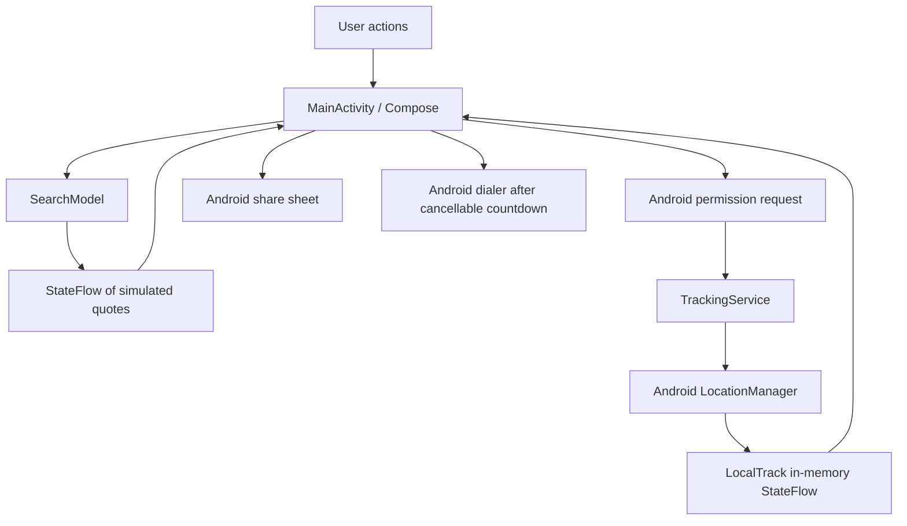

# RideHub architecture

RideHub is a Kotlin / Jetpack Compose Android prototype for comparing simulated ride offers and exploring user-controlled local location sharing. Provider names identify demo options; they do not imply an integration or partnership.

## Component map

There is no provider HTTP client or tracking backend in this flow. The application manifest does not request INTERNET permission. External browser, share-sheet and dialer actions run through Android intents.

## Source map

| Source | Responsibility |
| --- | --- |
| [MainActivity.kt](app/src/main/java/com/ridehub/app/MainActivity.kt) | Compose screens, transient UI state, permission request, share text and external intents |
| [Domain.kt](app/src/main/java/com/ridehub/app/Domain.kt) | Quote/search state, coroutine jobs, URL validation and future backend interface |
| [TrackingService.kt](app/src/main/java/com/ridehub/app/TrackingService.kt) | Foreground location service, notification Stop action and in-memory location state |
| [AndroidManifest.xml](app/src/main/AndroidManifest.xml) | Permissions, private location service and backup configuration |
| [SearchTest.kt](app/src/test/java/com/ridehub/app/SearchTest.kt) | Independent cancellation/type changes and retry behavior |
| [LinkTest.kt](app/src/test/java/com/ridehub/app/LinkTest.kt) | Supported URL shape and unsafe URL rejection |

## Search flow and stale results

1. A provider search cancels that provider's prior job and increments its generation.
2. The model marks the quote Searching and launches a coroutine with a simulated delay.
3. A result becomes Ready only when its captured generation still matches the current quote.
4. Changing ride type cancels that provider's search, clears its fare and returns it to Idle. Other providers continue independently.

Cancellation stops the prior coroutine; the generation comparison also protects against a stale success updating the latest selection. A SupervisorJob separates coroutine failure propagation, and the scope is cancelled when the ViewModel is cleared. Fares are deterministic demo values, not fetched market quotes.

## Location and sharing flow

The user requests tracking while the activity is visible. The service checks coarse location permission, creates a foreground notification and chooses GPS when precise permission and an enabled GPS provider are available; otherwise it attempts the network provider. Requested updates use a five-second interval and ten-metre distance, which are requests rather than delivery guarantees.

Location and status are held in LocalTrack StateFlows. Stopping the service removes updates and clears the current location. START_NOT_STICKY avoids an automatic service restart after termination.

Sharing builds a text payload only after a user action. It labels rides as simulated and includes a one-time location snapshot when the current wall-clock freshness check is below two minutes. Android's share sheet lets the user select the destination or cancel. No recipient is contacted automatically.

The current freshness calculation uses the location's wall-clock timestamp. Clock changes and future timestamps need explicit handling before relying on this check in production; a monotonic location-age calculation is a future improvement.

## Data lifetime

| Data | Storage / lifetime |
| --- | --- |
| Onboarding flag and manually entered contacts | Device-private SharedPreferences; backup disabled |
| Pickup, destination, selected quote, demo trip, pasted link | Compose remember state; no durable trip history |
| Search quotes and jobs | ViewModel lifetime; process-local |
| GPS fix and tracking status | Process memory; location cleared on service destruction |
| Shared text | Handed to the selected external app; its retention is outside RideHub's control |

A saved trusted contact is a local reference, not an automatic alert recipient. Pasted provider links and location snapshots should never be committed as public examples.

## URL and SOS boundaries

permittedRapidoLink accepts only HTTPS, the exact trk.rapido.bike host, no explicit port/user info/query/fragment, and the supported /RAPIDO/ path with a 24-character hexadecimal token. Shape validation does not prove a trip exists, the link is owned, or the token is current. The application opens supported links externally without extracting their content.

SOS uses a cancellable countdown and ACTION_DIAL. The user still has to place the call. The countdown is cleared when the activity stops. This prototype does not dispatch emergency assistance or notify contacts.

## Tradeoffs and next engineering work

- Compose UI and Android side effects share one activity for a compact prototype. Extract share-payload construction, freshness checks and trip state before growing the feature set.
- The ViewModel survives ordinary activity recreation, while many remember values do not. Saved state and lifecycle/device testing are needed for predictable recovery.
- The current StateFlow list update assumes serialized use through the default main dispatcher. Revisit atomic updates if a real provider layer introduces concurrent writers.
- Search tests use real coroutine delays. A virtual test scheduler would make broader timing coverage faster and more controlled.
- LiveTrackingGateway declares create/publish/revoke operations only. Authentication, expiry, consent, revocation and a viewer remain future work; no hosted link is generated.
- A licensed mapping SDK and authorized provider APIs would be required for real routes, availability, fares and booking.

## Evidence and acceptance

The [17 October 2026 cloud run](https://github.com/niwasrepalle/ridehub/actions/runs/39008367123) passed JVM tests, lint and debug APK assembly. Those results cover the earlier tested source, not physical Android behavior. This architecture addition changes documentation only.

Use [DEVICE-CHECKS.md](DEVICE-CHECKS.md) and [DEVICE-TEST-RESULTS.md](DEVICE-TEST-RESULTS.md) for permission, GPS, sharing, interruption and dialer acceptance. Existing NOT RUN entries must remain so until actual observations are recorded. See [VALIDATION.md](VALIDATION.md) for build evidence.
